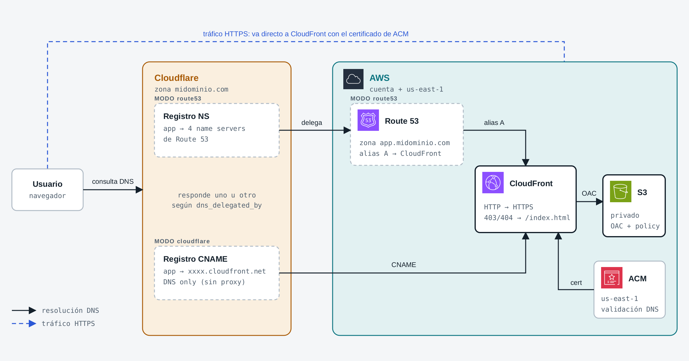
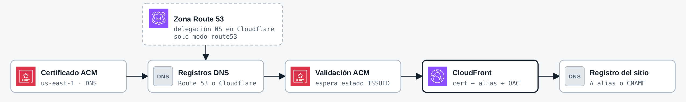

# tf-aws-demo

[English](#english) | [Español](#español)

---

## English

Static website on AWS: an Angular app served from a private S3 bucket behind CloudFront (using Origin Access Control), published on a custom subdomain with an ACM certificate.

The root domain is managed in Cloudflare, and the subdomain's DNS can be resolved in two ways depending on the `dns_delegated_by` variable. The infrastructure is defined with Terraform and its state is stored in a remote S3 backend.



*Dashed border: resources that exist only in that `dns_delegated_by` mode.*

### Structure

```
tf-aws-demo/
├── app/                  # Angular app (Tailwind + Vitest)
│   ├── src/
│   └── dist/app/browser  # production build (generated, ignored by git)
├── docs/                 # architecture diagrams (SVG and PNG)
├── infra/                # Terraform: web + CloudFront + DNS (remote state in S3)
│   ├── backend.tf        # S3 state backend
│   ├── provider.tf       # providers: aws (default and us_east_1 alias) and cloudflare
│   ├── variables.tf      # variables: bucket, domain, subdomain, token and DNS provider
│   ├── locals.tf         # derived names (bucket, origin id, fqdn) and is_route53 / is_cloudflare flags
│   ├── data.tf           # account/region, bucket policy, cache policy and Cloudflare zone
│   ├── s3.tf             # web bucket, public access block and policy
│   ├── cloudfront.tf     # OAC and CloudFront distribution
│   ├── dns.tf            # ACM certificate and its validation (shared by both modes)
│   ├── dns_route53.tf    # route53 mode: hosted zone, validation records and alias A
│   ├── dns_cloudflare.tf # Cloudflare records: NS delegation (route53 mode), validation and CNAME (cloudflare mode)
│   ├── outputs.tf        # outputs: bucket, CloudFront, URL, name servers and commands
│   └── bootstrap/        # creates the state S3 bucket (local state)
└── modules/              # reserved for modules (empty for now)
```

> `infra/bootstrap/` lives inside `infra/` but is an independent configuration: Terraform does not walk subdirectories, so each one is initialized and applied separately.

### Requirements

- Terraform `~> 1.16.4`
- AWS CLI with configured credentials (the default `aws` provider uses the `us-east-1` region)
- Permissions to create S3 buckets, CloudFront distributions, ACM certificates and, in `route53` mode, Route 53 hosted zones
- A domain with its DNS zone in Cloudflare
- A Cloudflare API token with `Zone:DNS:Edit` permission on that zone
- Node.js and npm (to build the Angular app)

### Infrastructure setup

The remote backend needs the state bucket to exist before it can be used, so it is created first with `infra/bootstrap/` (local state).

#### Phase 1: Backend bootstrap

1. Go to `infra/bootstrap/`:
   ```bash
   cd infra/bootstrap
   ```
2. Initialize and apply:
   ```bash
   terraform init
   terraform apply
   ```
3. Note the bucket name shown by the `state_bucket` output.
   Its format is `<state_bucket_name>-<account_id>-<region>-an`
   (by default `tf-state-aws-static-site-<account_id>-us-east-1-an`).

> The bootstrap state stays local in `infra/bootstrap/terraform.tfstate` and is excluded from the repository by `.gitignore`.

#### Phase 2: Connect `infra/` to the remote backend

1. Edit `infra/backend.tf` and set the bucket obtained in phase 1:
   ```hcl
   terraform {
     backend "s3" {
       bucket       = "<bootstrap-bucket>"
       key          = "frontend/terraform.tfstate"
       region       = "us-east-1"
       use_lockfile = true
     }
   }
   ```
2. Initialize from `infra/`:
   ```bash
   cd ..
   terraform init
   ```

#### Phase 3: Configure variables

| Variable | Description | Sensitive |
| --- | --- | --- |
| `web_bucket_name` | Prefix of the web bucket (default `web-aws-static-site`) | no |
| `domain_name` | Root domain managed in Cloudflare, e.g. `mydomain.com` | no |
| `subdomain` | Website subdomain, e.g. `app` | no |
| `cloudflare_api_token` | Cloudflare API token with `Zone:DNS:Edit` | yes |
| `dns_delegated_by` | Where the subdomain's DNS is resolved: `cloudflare` or `route53` (any other value fails validation) | no |

`domain_name`, `subdomain`, `cloudflare_api_token` and `dns_delegated_by` have no default value. The non-sensitive values go in `infra/terraform.tfvars` (excluded from the repo by `.gitignore`):

```hcl
domain_name      = "mydomain.com"
subdomain        = "app"
dns_delegated_by = "cloudflare" # or "route53"
```

The token is sensitive: pass it through an environment variable instead of keeping it in a file:

```bash
export TF_VAR_cloudflare_api_token="<token>"
```

With that, the website is served at `https://<subdomain>.<domain_name>`.

#### Phase 4: Deploy bucket, CloudFront and DNS

From `infra/`:

```bash
terraform plan
terraform apply
```

What gets created depending on `dns_delegated_by`:

| Resource | `route53` | `cloudflare` |
| --- | --- | --- |
| Private S3 bucket, OAC and CloudFront distribution | ✔ | ✔ |
| ACM certificate in `us-east-1` and its validation | ✔ | ✔ |
| Route 53 hosted zone for the subdomain | ✔ | – |
| 4 NS records in Cloudflare delegating to Route 53 | ✔ | – |
| ACM validation records | in Route 53 | in Cloudflare (DNS only) |
| Record pointing to CloudFront | A (alias) in Route 53 | CNAME in Cloudflare (DNS only) |

Creation order (ACM validation must finish before CloudFront can use the certificate):



> Certificate validation depends on the DNS records having propagated (and, in `route53` mode, on the NS delegation), so the first `apply` may take several minutes at `aws_acm_certificate_validation`.

> Changing `dns_delegated_by` on an existing infrastructure destroys the previous mode's records and creates the new ones. Review the `plan` before applying.

Check that the state ended up in S3:

```bash
aws s3 ls s3://<bootstrap-bucket>/frontend/
```

Available outputs (`terraform output` from `infra/`):

| Output | Description |
| --- | --- |
| `s3_web_bucket` | Web bucket name, format `<web_bucket_name>-<account_id>-<region>-an` (by default `web-aws-static-site-<account_id>-us-east-1-an`) |
| `cloudfront_domain_name` | CloudFront domain (`<id>.cloudfront.net`) |
| `cloudfront_distribution_id` | CloudFront distribution ID |
| `cmd_s3_sync_app` | `aws s3 sync` command to upload the app `dist` to the bucket (path relative to `infra/`) |
| `cmd_cf_invalidation` | `aws cloudfront create-invalidation` command already built with the distribution ID |
| `url` | Public URL of the website (`https://<subdomain>.<domain_name>`) |
| `name_servers` | Route 53 hosted zone NS; `null` in `cloudflare` mode. They must match the NS records created in Cloudflare |

### App deployment

#### 1. Build the app

```bash
cd app
npm ci
npm run build
```

The production build ends up in `app/dist/app/browser`.

#### 2. Upload the `dist` to the S3 bucket

From `app/`, sync the build with the web bucket (the name is read from the Terraform output):

```bash
aws s3 sync dist/app/browser s3://$(terraform -chdir=../infra output -raw s3_web_bucket) --delete
```

Or specifying the bucket directly:

```bash
aws s3 sync dist/app/browser s3://<web-bucket> --delete
```

You can also run the command returned by the `cmd_s3_sync_app` output, from `infra/` (the `dist` path is relative to that folder):

```bash
cd infra
eval "$(terraform output -raw cmd_s3_sync_app)"
```

`--delete` removes from the bucket the files that no longer exist in the build (Angular bundles have a hash in their name, so each build leaves old files behind). Remove it if the bucket holds other files.

#### 3. Invalidate the CloudFront cache

The distribution uses the managed cache policy `Managed-CachingOptimized` (default TTL of 24 hours), so without invalidating, `index.html` may take a while to reflect the new build. Run the command returned by the `cmd_cf_invalidation` output (from `app/`):

```bash
eval "$(terraform -chdir=../infra output -raw cmd_cf_invalidation)"
```

It is equivalent to:

```bash
aws cloudfront create-invalidation --distribution-id <distribution-id> --paths '/'
```

The ID comes from the `cloudfront_distribution_id` output. That command only invalidates the `/` path; to invalidate all content use `--paths '/*'`.

#### 4. Open the website

```bash
terraform -chdir=../infra output -raw url
```

### Notes

- The web bucket is private: only CloudFront can read it (policy with the distribution's `AWS:SourceArn`).
- **Demo only:** the web bucket uses `force_destroy = true` (`infra/s3.tf`) so `terraform destroy` can delete it even if it still contains the `dist` uploaded with `aws s3 sync`. This flag deletes all objects without asking; for an environment with real data, remove it and use `prevent_destroy = true` instead.
- CloudFront redirects HTTP to HTTPS and uses TLS `TLSv1.2_2021` with SNI.
- CloudFront 403/404 errors respond with `/index.html` (200) to support Angular routing.
- The ACM certificate must be in `us-east-1` for CloudFront; that is why it is created with the `aws.us_east_1` provider.
- In Cloudflare, the ACM validation records and the CNAME to CloudFront use `proxied = false` (DNS only): TLS is terminated by CloudFront with the ACM certificate.
- The Cloudflare token is sensitive: do not commit it to the repo.

---

## Español

Web estática en AWS: una app Angular servida desde un bucket S3 privado detrás de CloudFront (con Origin Access Control), publicada en un subdominio propio con certificado ACM.

El dominio raíz se gestiona en Cloudflare y el DNS del subdominio se puede resolver de dos formas, según la variable `dns_delegated_by`. La infraestructura se define con Terraform y su state se guarda en un backend remoto en S3.


*Borde punteado: recursos que existen solo en ese modo de `dns_delegated_by`.*

### Estructura

```
tf-aws-demo/
├── app/                  # App Angular (Tailwind + Vitest)
│   ├── src/
│   └── dist/app/browser  # build de producción (generado, ignorado por git)
├── docs/                 # diagramas de arquitectura (SVG y PNG)
├── infra/                # Terraform: web + CloudFront + DNS (state remoto en S3)
│   ├── backend.tf        # backend S3 del state
│   ├── provider.tf       # providers: aws (por defecto y alias us_east_1) y cloudflare
│   ├── variables.tf      # variables: bucket, dominio, subdominio, token y proveedor DNS
│   ├── locals.tf         # nombres derivados (bucket, origin id, fqdn) y flags is_route53 / is_cloudflare
│   ├── data.tf           # account/region, policy del bucket, cache policy y zona de Cloudflare
│   ├── s3.tf             # bucket de la web, bloqueo de acceso público y policy
│   ├── cloudfront.tf     # OAC y distribución CloudFront
│   ├── dns.tf            # certificado ACM y su validación (común a ambos modos)
│   ├── dns_route53.tf    # modo route53: hosted zone, registros de validación y alias A
│   ├── dns_cloudflare.tf # registros en Cloudflare: delegación NS (modo route53), validación y CNAME (modo cloudflare)
│   ├── outputs.tf        # outputs: bucket, CloudFront, URL, name servers y comandos
│   └── bootstrap/        # crea el bucket S3 del state (state local)
└── modules/              # reservado para módulos (vacío por ahora)
```

> `infra/bootstrap/` está dentro de `infra/` pero es una configuración independiente: Terraform no recorre subdirectorios, así que cada una se inicializa y aplica por separado.

### Requisitos

- Terraform `~> 1.16.4`
- AWS CLI con credenciales configuradas (el provider `aws` por defecto usa la región `us-east-1`)
- Permisos para crear buckets S3, distribuciones CloudFront, certificados ACM y, en modo `route53`, hosted zones de Route 53
- Un dominio con su zona DNS en Cloudflare
- Un API token de Cloudflare con permiso `Zone:DNS:Edit` sobre esa zona
- Node.js y npm (para construir la app Angular)

### Inicialización de la infraestructura

El backend remoto necesita que el bucket del state exista antes de usarlo, por eso se crea primero con `infra/bootstrap/` (state local).

#### Fase 1: Bootstrap del backend

1. Entrar a `infra/bootstrap/`:
   ```bash
   cd infra/bootstrap
   ```
2. Inicializar y aplicar:
   ```bash
   terraform init
   terraform apply
   ```
3. Anotar el nombre del bucket que muestra el output `state_bucket`.
   Tiene el formato `<state_bucket_name>-<account_id>-<region>-an`
   (por defecto `tf-state-aws-static-site-<account_id>-us-east-1-an`).

> El state del bootstrap queda local en `infra/bootstrap/terraform.tfstate` y está excluido del repositorio por `.gitignore`.

#### Fase 2: Conectar `infra/` al backend remoto

1. Editar `infra/backend.tf` y poner el bucket obtenido en la fase 1:
   ```hcl
   terraform {
     backend "s3" {
       bucket       = "<bucket-del-bootstrap>"
       key          = "frontend/terraform.tfstate"
       region       = "us-east-1"
       use_lockfile = true
     }
   }
   ```
2. Inicializar desde `infra/`:
   ```bash
   cd ..
   terraform init
   ```

#### Fase 3: Configurar variables

| Variable | Descripción | Sensible |
| --- | --- | --- |
| `web_bucket_name` | Prefijo del bucket de la web (por defecto `web-aws-static-site`) | no |
| `domain_name` | Dominio raíz gestionado en Cloudflare, ej. `midominio.com` | no |
| `subdomain` | Subdominio de la web, ej. `app` | no |
| `cloudflare_api_token` | API token de Cloudflare con `Zone:DNS:Edit` | sí |
| `dns_delegated_by` | Dónde se resuelve el DNS del subdominio: `cloudflare` o `route53` (cualquier otro valor falla en la validación) | no |

`domain_name`, `subdomain`, `cloudflare_api_token` y `dns_delegated_by` no tienen valor por defecto. Los valores no sensibles van en `infra/terraform.tfvars` (excluido del repo por `.gitignore`):

```hcl
domain_name      = "midominio.com"
subdomain        = "app"
dns_delegated_by = "cloudflare" # o "route53"
```

El token es sensible: se recomienda pasarlo por variable de entorno en vez de dejarlo en un archivo:

```bash
export TF_VAR_cloudflare_api_token="<token>"
```

Con eso la web queda en `https://<subdomain>.<domain_name>`.

#### Fase 4: Desplegar bucket, CloudFront y DNS

Desde `infra/`:

```bash
terraform plan
terraform apply
```

Qué crea según `dns_delegated_by`:

| Recurso | `route53` | `cloudflare` |
| --- | --- | --- |
| Bucket S3 privado, OAC y distribución CloudFront | ✔ | ✔ |
| Certificado ACM en `us-east-1` y su validación | ✔ | ✔ |
| Hosted zone de Route 53 del subdominio | ✔ | – |
| 4 registros NS en Cloudflare que delegan a Route 53 | ✔ | – |
| Registros de validación ACM | en Route 53 | en Cloudflare (DNS only) |
| Registro hacia CloudFront | A (alias) en Route 53 | CNAME en Cloudflare (DNS only) |

Orden de creación (la validación de ACM debe terminar antes de que CloudFront pueda usar el certificado):


> La validación del certificado depende de que los registros DNS ya se hayan propagado (y, en modo `route53`, de la delegación NS), por lo que el primer `apply` puede tardar varios minutos en `aws_acm_certificate_validation`.

> Cambiar `dns_delegated_by` en una infraestructura ya creada destruye los registros del modo anterior y crea los del nuevo. Revisa el `plan` antes de aplicar.

Verificar que el state quedó en S3:

```bash
aws s3 ls s3://<bucket-del-bootstrap>/frontend/
```

Outputs disponibles (`terraform output` desde `infra/`):

| Output | Descripción |
| --- | --- |
| `s3_web_bucket` | Nombre del bucket de la web, formato `<web_bucket_name>-<account_id>-<region>-an` (por defecto `web-aws-static-site-<account_id>-us-east-1-an`) |
| `cloudfront_domain_name` | Dominio de CloudFront (`<id>.cloudfront.net`) |
| `cloudfront_distribution_id` | ID de la distribución CloudFront |
| `cmd_s3_sync_app` | Comando `aws s3 sync` para subir el `dist` de la app al bucket (ruta relativa a `infra/`) |
| `cmd_cf_invalidation` | Comando `aws cloudfront create-invalidation` ya armado con el ID de la distribución |
| `url` | URL pública de la web (`https://<subdomain>.<domain_name>`) |
| `name_servers` | NS de la hosted zone de Route 53; `null` en modo `cloudflare`. Deben coincidir con los registros NS creados en Cloudflare |

### Despliegue de la app

#### 1. Construir la app

```bash
cd app
npm ci
npm run build
```

El build de producción queda en `app/dist/app/browser`.

#### 2. Subir el `dist` al bucket S3

Desde `app/`, sincronizar el build con el bucket de la web (el nombre se lee del output de Terraform):

```bash
aws s3 sync dist/app/browser s3://$(terraform -chdir=../infra output -raw s3_web_bucket) --delete
```

O indicando el bucket directamente:

```bash
aws s3 sync dist/app/browser s3://<bucket-web> --delete
```

También se puede ejecutar el comando que entrega el output `cmd_s3_sync_app`, desde `infra/` (la ruta del `dist` es relativa a esa carpeta):

```bash
cd infra
eval "$(terraform output -raw cmd_s3_sync_app)"
```

`--delete` elimina del bucket los archivos que ya no existen en el build (los bundles de Angular llevan hash en el nombre, así que cada build deja archivos viejos). Quitarlo si el bucket guarda otros archivos.

#### 3. Invalidar la caché de CloudFront

La distribución usa la cache policy administrada `Managed-CachingOptimized` (TTL por defecto de 24 horas), así que sin invalidar, `index.html` puede tardar en reflejar el nuevo build. Ejecutar el comando que entrega el output `cmd_cf_invalidation` (desde `app/`):

```bash
eval "$(terraform -chdir=../infra output -raw cmd_cf_invalidation)"
```

Equivale a:

```bash
aws cloudfront create-invalidation --distribution-id <distribution-id> --paths '/'
```

El ID sale del output `cloudfront_distribution_id`. Ese comando invalida solo la ruta `/`; para invalidar todo el contenido usar `--paths '/*'`.

#### 4. Abrir la web

```bash
terraform -chdir=../infra output -raw url
```

### Notas

- El bucket de la web es privado: solo CloudFront puede leerlo (policy con `AWS:SourceArn` de la distribución).
- **Solo para la demo:** el bucket de la web usa `force_destroy = true` (`infra/s3.tf`) para que `terraform destroy` pueda eliminarlo aunque aún contenga el `dist` subido con `aws s3 sync`. Este flag borra todos los objetos sin preguntar; en un entorno con datos reales conviene quitarlo y usar `prevent_destroy = true`.
- CloudFront redirige HTTP a HTTPS y usa TLS `TLSv1.2_2021` con SNI.
- Los errores 403/404 de CloudFront responden con `/index.html` (200) para soportar el routing de Angular.
- El certificado ACM debe estar en `us-east-1` para CloudFront; por eso se crea con el provider `aws.us_east_1`.
- En Cloudflare, los registros de validación de ACM y el CNAME hacia CloudFront van con `proxied = false` (DNS only): el TLS lo termina CloudFront con el certificado de ACM.
- El token de Cloudflare es sensible: no lo subas al repo.
